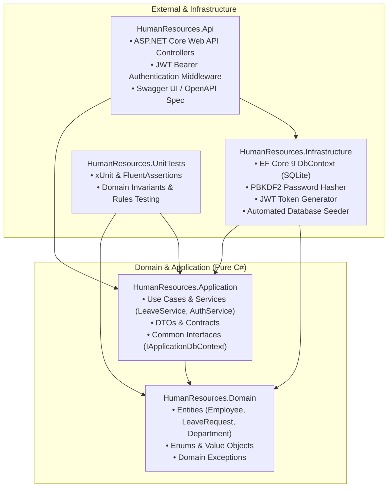
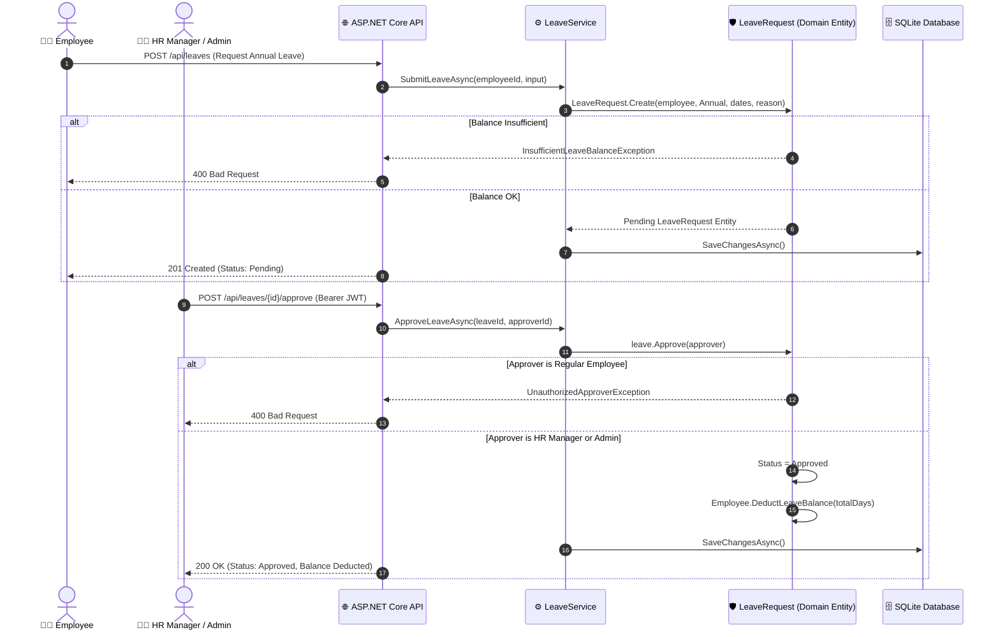

# 🏢 HR Management & Leave Approval Engine — .NET Clean Architecture

[](https://dotnet.microsoft.com/)
[](https://blog.cleancoder.com/uncle-bob/2012/08/13/the-clean-architecture.html)
[](https://jwt.io/)
[](https://learn.microsoft.com/ef/core/)
[-success)](#-unit-tests)
[](LICENSE)

> 🌐 **Language / Dil:** [🇬🇧 English](#-english) | [🇹🇷 Türkçe](#-türkçe)

---

<a name="english"></a>
## 🇬🇧 English

An enterprise-ready **Human Resources & Employee Leave Management Web API** built with **Clean Architecture**, **Domain-Driven Design (DDD)** principles, **Role-Based Access Control (RBAC)**, and **Entity Framework Core**.

This project modernizes classic relational HR database structures into a modern, production-grade microservice with self-encapsulating domain invariants, strict authorization boundaries, and automated database seeding.

### 🏛️ System Architecture

The solution adheres strictly to Uncle Bob's **Clean Architecture** and the Dependency Inversion Principle. Dependencies flow inward toward the pure **Domain** core.



### 🔒 Domain-Driven Design (DDD) Invariants

Unlike anemic domain models where business logic leaks into UI controllers or generic services, all core business rules are strictly enforced inside Domain Entities:

| Invariant / Rule | Enforced In | Domain Exception |
| :--- | :--- | :--- |
| **Insufficient Balance** | `LeaveRequest.Create()` | `InsufficientLeaveBalanceException` (HTTP 400) |
| **Invalid Date Range** | `LeaveRequest.Create()` | `InvalidLeaveOperationException` (HTTP 400) |
| **Unauthorized Approver** | `LeaveRequest.Approve()` | `UnauthorizedApproverException` (HTTP 400) |
| **Double Approval Guard** | `LeaveRequest.Approve()` | `InvalidLeaveOperationException` (HTTP 400) |
| **Mandatory Rejection Reason** | `LeaveRequest.Reject()` | `InvalidLeaveOperationException` (HTTP 400) |
| **Ownership Cancellation** | `LeaveRequest.Cancel()` | `InvalidLeaveOperationException` (HTTP 400) |

#### Leave Approval Workflow



### 🚀 Pre-Seeded Test Accounts

The system automatically initializes and seeds a local SQLite database (`humanresources.db`) on the first startup with ready-to-test corporate personas:

| Role | Email | Password | Annual Leave Balance | Access Scope |
| :--- | :--- | :--- | :---: | :--- |
| **Admin** | `admin@company.com` | `Password123!` | 25 days | Full system access, Department creation, Leave approval |
| **HR Manager** | `sarah.hr@company.com` | `Password123!` | 20 days | Employee management, Leave approval & rejection |
| **Employee** | `emre.salgir@company.com` | `Password123!` | 15 days | Submit leaves, track own requests, cancel own pending leaves |
| **Employee** | `michael.scott@company.com` | `Password123!` | 12 days | Submit leaves, track own requests |

### 📡 API Endpoints

- **Auth:** `POST /api/auth/login` — Login with email/password and obtain JWT Bearer Token.
- **Leaves (Employee):**
  - `GET /api/leaves/my` — Get leave requests submitted by the logged-in user `[Authorize]`.
  - `POST /api/leaves` — Submit a new leave request (Annual, Sick, Maternity, Unpaid) `[Authorize]`.
  - `GET /api/leaves/{id}` — Get single leave request details `[Authorize]`.
  - `POST /api/leaves/{id}/cancel` — Cancel user's own pending request `[Authorize]`.
- **Leaves (Management):**
  - `GET /api/leaves` — List all employee leaves with optional status filter `[Authorize(Roles = "HRManager,Admin")]`.
  - `POST /api/leaves/{id}/approve` — Approve pending request and deduct balance `[Authorize(Roles = "HRManager,Admin")]`.
  - `POST /api/leaves/{id}/reject` — Reject request with mandatory reason `[Authorize(Roles = "HRManager,Admin")]`.
- **Employees & Departments:**
  - `GET /api/employees` — List all employees with department data `[Authorize]`.
  - `GET /api/employees/{id}` — Get employee details by ID `[Authorize]`.
  - `POST /api/employees` — Register a new employee `[Authorize(Roles = "HRManager,Admin")]`.
  - `GET /api/departments` — List departments and active headcount `[Authorize]`.
  - `POST /api/departments` — Create a department `[Authorize(Roles = "Admin")]`.

### 🧪 Unit Tests

```bash
dotnet test
```

```text
Passed!  - Failed: 0, Passed: 16, Skipped: 0, Total: 16, Duration: 286 ms - HumanResources.UnitTests.dll (net10.0)
```

### 💻 Integrated Enterprise Web Dashboard (No npm / Node.js Required)

The project includes a built-in modern dark-slate enterprise web application served directly from `wwwroot` by ASP.NET Core:
- **Zero Framework Bloat:** High-performance, pure modular Vanilla JS (ES6+) and modern CSS tokens with zero broken external CDN dependencies.
- **1-Click Persona Switcher:** Switch between personas (Employee, HR Manager, Admin) with instant JWT token re-issuance and real-time UI adaptation.
- **Dynamic Domain Validation:** Calculates business days on the fly and triggers instant visual alerts if requested annual leave exceeds available balance before submission.
- **HR Approval Inbox:** Real-time inbox for HR Managers & Admins with 1-click approval and mandatory rejection reason modal.
- **Company Directory:** Live organization charts displaying departmental breakdown and active employee leave allowances.

### 🏃 Running the Application

```bash
# Clone & Build
git clone https://github.com/EmreSlgr/hr-management-clean-architecture.git
cd hr-management-clean-architecture
dotnet build

# Run both Web Dashboard & API
dotnet run --project src/HumanResources.Api
```

- 🖥️ **Web Dashboard UI:** **`http://localhost:5203/`**
- 📜 **Swagger API Documentation:** **`http://localhost:5203/swagger`**

---

<a name="türkçe"></a>
## 🇹🇷 Türkçe

**Clean Architecture**, **Domain-Driven Design (DDD)** prensipleri, **Rol Bazlı Yetkilendirme (RBAC)** ve **Entity Framework Core** ile geliştirilmiş, kurumsal düzeyde bir **İnsan Kaynakları & İzin Yönetim Web API'si**.

Bu proje, geleneksel ilişkisel veritabanı yapılarını; kendi kendini doğrulayan zengin domain modelleri, sıkı yetkilendirme sınırları ve otomatik veritabanı tohumlama (seeding) yeteneklerine sahip modern bir mikroservise dönüştürür.

### 🏛️ Sistem Mimarisi

Çözüm, Robert C. Martin'in (Uncle Bob) **Clean Architecture** prensiplerine ve Dependency Inversion ilkesine sıkı sıkıya bağlıdır. Bağımlılıklar daima dış katmanlardan içteki saf **Domain** çekirdeğine doğru akar.

- **`HumanResources.Domain`:** Harici kütüphane bağımlılığı olmayan saf C# katmanı. `Employee`, `LeaveRequest`, `Department` entity'leri, enum'lar ve domain istisnalarını barındırır.
- **`HumanResources.Application`:** İş akışları ve kullanım senaryoları (`LeaveService`, `AuthService`, `EmployeeService`, `DepartmentService`), DTO sözleşmeleri ve `IApplicationDbContext` arayüzü.
- **`HumanResources.Infrastructure`:** Entity Framework Core (SQLite), PBKDF2 Şifre Kriptolama, JWT Token Üretici ve ilk açılışta verileri otomatik yükleyen `DatabaseSeeder`.
- **`HumanResources.Api`:** ASP.NET Core Web API controller'ları, JWT Bearer kimlik doğrulama ara katmanı ve Swagger UI / OpenAPI entegrasyonu.
- **`HumanResources.UnitTests`:** Domain kurallarını ve sınır durumlarını doğrulayan xUnit ve FluentAssertions birim testleri.

### 🔒 Domain-Driven Design (DDD) Kuralları & Invariant'lar

İş mantığının controller'lara veya anemic (kansız) servislere sızdığı tasarımların aksine, tüm iş kuralları doğrudan Domain Entity'leri içinde garanti altına alınmıştır:

| Kural / Doğrulama | Korunduğu Yer | Fırlatılan Domain Hatası |
| :--- | :--- | :--- |
| **Yetersiz İzin Bakiyesi** | `LeaveRequest.Create()` | `InsufficientLeaveBalanceException` (HTTP 400) |
| **Geçersiz Tarih Aralığı** | `LeaveRequest.Create()` | `InvalidLeaveOperationException` (HTTP 400) |
| **Yetkisiz İzin Onaycısı** | `LeaveRequest.Approve()` | `UnauthorizedApproverException` (HTTP 400) |
| **Mükerrer Onay Engeli** | `LeaveRequest.Approve()` | `InvalidLeaveOperationException` (HTTP 400) |
| **Zorunlu Reddetme Sebebi** | `LeaveRequest.Reject()` | `InvalidLeaveOperationException` (HTTP 400) |
| **Kendi İznini İptal Edebilme**| `LeaveRequest.Cancel()` | `InvalidLeaveOperationException` (HTTP 400) |

### 🚀 Hazır Kurumsal Test Hesapları

Uygulama ilk kez çalıştırıldığında yerel SQLite veritabanını (`humanresources.db`) otomatik oluşturur ve test senaryoları için hazır kurumsal rolleri tohumlar (seed eder):

| Rol | E-Posta | Şifre | Yıllık İzin Hakkı | Yetki Kapsamı |
| :--- | :--- | :--- | :---: | :--- |
| **Admin** | `admin@company.com` | `Password123!` | 25 gün | Tam sistem yetkisi, Departman tanımlama, İzin onaylama |
| **HR Manager**| `sarah.hr@company.com` | `Password123!` | 20 gün | Personel yönetimi, İzin taleplerini onaylama ve reddetme |
| **Employee** | `emre.salgir@company.com` | `Password123!` | 15 gün | İzin talep etme, kendi taleplerini izleme/iptal etme |
| **Employee** | `michael.scott@company.com` | `Password123!` | 12 gün | İzin talep etme, kendi taleplerini izleme |

### 📡 API Uç Noktaları (Endpoints)

- **Kimlik Doğrulama:** `POST /api/auth/login` — E-posta ve şifreyle giriş yapıp JWT Bearer token alma.
- **İzin Yönetimi (Çalışan):**
  - `GET /api/leaves/my` — Giriş yapan kullanıcının kendi izin talepleri `[Authorize]`.
  - `POST /api/leaves` — Yeni izin talebi oluşturma (Yıllık, Hastalık, Doğum, Ücretsiz) `[Authorize]`.
  - `GET /api/leaves/{id}` — Tekil izin talebi detayı `[Authorize]`.
  - `POST /api/leaves/{id}/cancel` — Kullanıcının kendi onay bekleyen iznini iptal etmesi `[Authorize]`.
- **İzin Yönetimi (İK & Yönetim):**
  - `GET /api/leaves` — Şirketteki tüm izinleri listeleme (durum filtreli) `[Authorize(Roles = "HRManager,Admin")]`.
  - `POST /api/leaves/{id}/approve` — İzni onaylama ve çalışanın bakiyesinden otomatik düşme `[Authorize(Roles = "HRManager,Admin")]`.
  - `POST /api/leaves/{id}/reject` — Gerekçe belirterek izni reddetme `[Authorize(Roles = "HRManager,Admin")]`.
- **Personel & Departman:**
  - `GET /api/employees` — Aktif personelleri departman bilgileriyle listeleme `[Authorize]`.
  - `GET /api/employees/{id}` — Personel detayını getirme `[Authorize]`.
  - `POST /api/employees` — Yeni personel kaydetme `[Authorize(Roles = "HRManager,Admin")]`.
  - `GET /api/departments` — Departmanları ve çalışan sayılarını listeleme `[Authorize]`.
  - `POST /api/departments` — Yeni departman açma `[Authorize(Roles = "Admin")]`.

### 🧪 Birim Testler (Unit Tests)

xUnit ve FluentAssertions ile yazılmış 16 kapsamlı test; yetersiz bakiye, geçersiz tarih, yetkisiz onaycı gibi tüm domain kurallarını doğrular:

```bash
dotnet test
```

```text
Başarılı!  - Başarısız: 0, Başarılı: 16, Atlanan: 0, Toplam: 16 - HumanResources.UnitTests.dll (net10.0)
```

### 💻 Entegre Kurumsal Web Dashboard (npm / Node.js Gerektirmez)

Proje, doğrudan `src/HumanResources.Api/wwwroot` üzerinden ASP.NET Core tarafından sunulan yüksek performanslı, koyu temalı (dark-slate) modern bir web arayüzü barındırır:
- **Sıfır Ekstra Bağımlılık (No AI Slop):** Harici Node.js/npm paketlerine veya kırılgan CDN kütüphanelerine ihtiyaç duymaz; saf modüler modern JavaScript (ES6+) ve CSS değişkenleriyle milisaniyeler içinde yüklenir.
- **Canlı Rol Değiştirici (Persona Switcher):** Başlık çubuğundaki seçim kutusuyla tek tıkla *Emre Salgır (Çalışan)*, *Sarah Connor (İK Lideri)* veya *System Admin (CTO)* hesapları arasında geçiş yapabilir; her rol için backend'den anında gerçek JWT token üretilerek arayüz dinamik olarak güncellenir.
- **Dinamik Domain Kuralı Önizleme:** İzin modalında tarih seçildiğinde gün sayısını hesaplar; talep edilen yıllık izin çalışanın mevcut bakiyesini aşıyorsa daha talep gönderilmeden önce görsel uyarı tetikler.
- **İK Onay Masası:** Yalnızca `HRManager` ve `Admin` rollerine açılan onay masasında, çalışanların bekleyen izinleri listelenir; tek tıkla onaylanabilir veya zorunlu gerekçe girilerek reddedilebilir.
- **Şirket & Departman Organizasyon Şeması:** Departman bazında personel dağılımını ve kalan izin haklarını canlı gösterir.

### 🏃 Projeyi Çalıştırma Rehberi

#### Yöntem 1: VS Code Terminalinden
```bash
# Repoyu klonlayın ve klasöre girin
git clone https://github.com/EmreSlgr/hr-management-clean-architecture.git
cd hr-management-clean-architecture

# Web Dashboard & API'yi birlikte başlatın
dotnet run --project src/HumanResources.Api
```

- 🖥️ **Web Dashboard Arayüzü:** **`http://localhost:5203/`**
- 📜 **Swagger API Dokümantasyonu:** **`http://localhost:5203/swagger`**

#### Yöntem 2: VS Code F5 ile Hata Ayıklama (Debug)
1. Projeyi VS Code ile açın (`File -> Open Folder`).
2. Klavyeden **`F5`** tuşuna basın (hazır `.vscode/launch.json` profili otomatik devreye girer).
3. API ve Web Dashboard ayağa kalkacak, tarayıcınızda arayüz otomatik olarak açılacaktır.

---

## 🛠️ Teknolojiler & Prensipler / Tech Stack

- **Framework:** .NET 10 / ASP.NET Core Web API
- **Mimari:** Clean Architecture, Domain-Driven Design (DDD)
- **Veritabanı / ORM:** Entity Framework Core 9, SQLite
- **Güvenlik:** JWT (JSON Web Tokens), PBKDF2 Password Hashing, Role-Based Access Control (RBAC)
- **Test:** xUnit, FluentAssertions
- **Dokümantasyon:** Swagger / OpenAPI with Bearer Authorization

---

## 👤 Yazar / Author

**Emre Salgır**  
*Software Developer*

- GitHub: [@EmreSlgr](https://github.com/EmreSlgr)
- LinkedIn: [Emre Salgır](https://www.linkedin.com/in/emre-salg%C4%B1r-a98b21174/)

---

## 📄 Lisans / License

Bu proje [MIT Lisansı](LICENSE) altında lisanslanmıştır.
